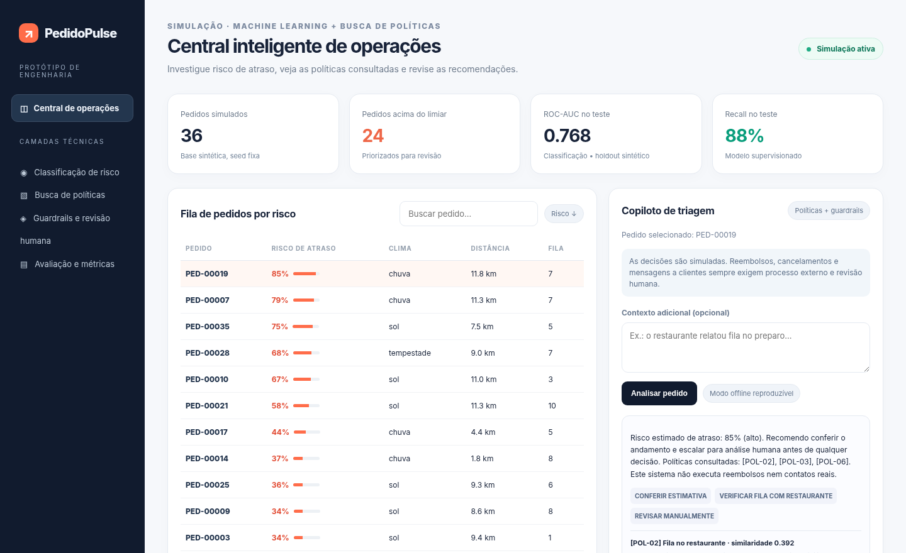

# PedidoPulse

**Uma demonstração de como priorizar pedidos com risco de atraso sem transformar uma previsão em decisão automática.**

[](https://github.com/lucastnunes06/pedidopulse-ai-operations/actions/workflows/ci.yml)   [](LICENSE)

O PedidoPulse surgiu como um estudo sobre priorização de uma fila de entregas fictícias. O modelo estima o risco de atraso; depois, uma busca por políticas oferece contexto para a triagem. A recomendação **não executa nenhuma ação** e deve ser interpretada por uma pessoa.

> **Escopo:** protótipo local, sem conexão com operações reais. Dados, pedidos, políticas e custos do experimento são sintéticos. O funcionamento básico não exige chave de API.

## Veja o painel



A captura e o GIF foram produzidos em navegador com os arquivos reais da interface e respostas calculadas pelo serviço local (sem conexão externa). O painel permite escolher um pedido, adicionar uma observação e conferir risco estimado, ações sugeridas e trechos de políticas recuperados. [Veja uma demonstração curta](docs/triage-demo.gif).

## O que está implementado

| Parte | Implementação | Onde olhar |
| --- | --- | --- |
| Previsão | Regressão logística com pré-processamento e separação cronológica de dados | [`app/model.py`](app/model.py) |
| Triagem | Regras de revisão de pedidos conforme o score | [`app/service.py`](app/service.py) |
| Contexto | Busca lexical TF-IDF sobre seis políticas fictícias | [`app/knowledge.py`](app/knowledge.py) |
| Explicação | Texto offline ou integração opcional com Groq | [`app/llm.py`](app/llm.py) |
| Interface | Dashboard e API REST com FastAPI | [`app/main.py`](app/main.py) · [`app/static/`](app/static/) |
| Verificação | Testes automatizados, workflow de CI e estudo de limiares | [`tests/`](tests/) · [`docs/DECISOES_E_TESTES.md`](docs/DECISOES_E_TESTES.md) |

## Rodar no computador

Requer **Python 3.11+** e Git. Faça o clone e instale as dependências:

```bash
git clone https://github.com/lucastnunes06/pedidopulse-ai-operations.git
cd pedidopulse-ai-operations
python -m venv .venv
```

Ative o ambiente (Linux/macOS: `source .venv/bin/activate`; Windows PowerShell: `.venv\Scripts\Activate.ps1`) e execute:

```bash
pip install -r requirements.txt
python scripts/train.py
uvicorn app.main:app --reload
```

- Painel: **http://127.0.0.1:8000**
- Documentação interativa da API: **http://127.0.0.1:8000/docs**

Uma triagem também pode ser solicitada sem a interface:

```bash
curl -X POST http://127.0.0.1:8000/api/triage/PED-00019 \
  -H "Content-Type: application/json" \
  -d '{"note":"Fila alta no restaurante","mode":"offline"}'
```

Para testar geração de texto via LLM, configure `GROQ_API_KEY` no ambiente e use `"mode":"groq"`. O serviço principal funciona offline. **Não envie dados pessoais ou chaves ao repositório.**

## O experimento que vale olhar

Uma decisão que afeta muito o resultado é **qual score deve mandar um pedido para revisão**. O modelo original escolhe um limiar de **0,16**, atribuindo custos simulados de 5 unidades a um falso negativo e 1 a um falso positivo. O estudo compara a sensibilidade da escolha mantendo o mesmo modelo e alterando somente essa hipótese de custo.

| Peso do falso negativo | Limiar escolhido na validação | Recall no teste | Falsos positivos em 800 pedidos |
| ---: | ---: | ---: | ---: |
| 1 | 0,46 | 40,3% | 57 |
| 3 | 0,28 | 71,0% | 149 |
| **5 (padrão)** | **0,16** | **87,9%** | **327** |
| 10 | 0,12 | 93,5% | 398 |

O limiar de 0,16 recupera mais atrasos simulados, mas faz a equipe hipotética revisar **545 pedidos em 800**. Com limiar 0,46, a fila cai para **157**, mas o recall também diminui. **Não há escolha certa sem conhecer a operação**, seus custos e sua capacidade de revisão.

O experimento é reproduzível:

```bash
python -m scripts.threshold_experiment
pytest -q
```

Resultados completos: [`artifacts/threshold_study.json`](artifacts/threshold_study.json) · [Como interpretei os trade-offs](docs/DECISOES_E_TESTES.md).

O modelo registra **ROC-AUC 0,7684** e **precisão 40,0%** no holdout sintético. Os números não representam desempenho em produção. [Métricas originais](artifacts/metrics.json).

## Por que fiz algumas escolhas

Usei regressão logística para manter o processo de treino e a análise de scores compreensíveis. A busca por políticas é **lexical**, com TF-IDF: é simples, rastreável e suficiente para uma demonstração pequena, mas não equivale a recuperação semântica com embeddings. A LLM opcional redige explicações; a seleção de ações continua determinada pelo código.

Também separei o antigo arquivo único de front-end em HTML, CSS e JavaScript para facilitar a manutenção. [Arquitetura e limites](docs/ARQUITETURA.md) · [Decisões e verificações](docs/DECISOES_E_TESTES.md).

## O que ainda não está resolvido

Os rótulos foram gerados artificialmente; o filtro de prompt injection é ilustrativo; as políticas são fictícias e a API não tem autenticação nem mecanismos de produção. A próxima etapa técnica seria trabalhar com dados reais autorizados, validar calibração e drift, testar segurança com casos adversariais e avaliar a utilidade das recomendações com pessoas.

## Sobre a construção

Projeto de estudo mantido por [Lucas Nunes](https://github.com/lucastnunes06). A implementação inicial e parte da documentação contaram com assistência de IA. Este fato é explicitado para diferenciar o processo de criação das evidências técnicas que podem ser reproduzidas. Os experimentos documentados são reproduzíveis, e o repositório não afirma uso comercial, atuação com clientes reais ou operação em produção.

Licença [MIT](LICENSE).
