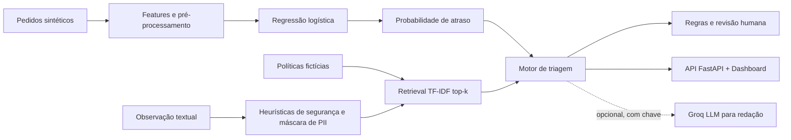

<div align="center">

# PedidoPulse

### AI Operations Copilot · Machine Learning + RAG + FastAPI

**Transformando sinais de uma operação simulada em prioridades de análise, recomendações explicáveis e decisões sob supervisão humana.**

[](https://github.com/lucastnunes06/pedidopulse-ai-operations/actions/workflows/ci.yml)


**[Explorar a arquitetura](docs/ARQUITETURA.md) · [Ver os testes](tests/test_quality.py) · [Consultar as métricas](artifacts/metrics.json)**

</div>

> [!IMPORTANT]
> **Projeto independente, educacional e executado localmente.** Os pedidos, políticas e resultados são **100% sintéticos**. Não há clientes reais, conexão com plataformas de entrega, ações externas nem validação em produção. A integração com LLM é opcional.

## Em 30 segundos

Uma fila de pedidos não informa, por si só, quais situações merecem atenção primeiro. O **PedidoPulse** demonstra um fluxo completo de engenharia de IA: estima o risco de atraso com um modelo supervisionado, recupera políticas operacionais relevantes e produz recomendações **com referências e revisão humana**.

| Etapa | O que acontece | Evidência no código |
| --- | --- | --- |
| **Prever** | Um pipeline de classificação estima a probabilidade de atraso. | [`app/model.py`](app/model.py) |
| **Priorizar** | Os pedidos fictícios são ordenados pelo risco e exibidos em um painel web. | [`app/service.py`](app/service.py) · [`app/static/`](app/static/) |
| **Fundamentar** | Busca lexical TF-IDF recupera políticas com IDs e escores de similaridade. | [`app/knowledge.py`](app/knowledge.py) |
| **Recomendar** | Regras determinísticas sugerem acompanhamento ou revisão humana. | [`app/service.py`](app/service.py) |
| **Proteger** | Filtros ilustrativos detectam alguns padrões de prompt injection e mascaram contatos. | [`app/llm.py`](app/llm.py) |
| **Validar** | Métricas em holdout, baseline, suíte de retrieval, testes de API e CI. | [`artifacts/`](artifacts/) · [`tests/`](tests/) |

### O que torna o projeto diferente

- **ML avaliado, não só treinado:** divisão cronológica 60/20/20, limiar escolhido na validação e teste separado, com baseline explícito.
- **RAG rastreável, não uma resposta sem fonte:** cada recomendação traz as políticas recuperadas (`POL-01` a `POL-06`). Aqui o retrieval é **lexical (TF-IDF)**, não baseado em embeddings.
- **LLM com autoridade limitada:** o modo offline funciona sem chave; no modo opcional com Groq, a geração redige uma explicação, mas **não escolhe ações executáveis**.
- **Software utilizável:** API REST documentada, painel, dados reproduzíveis, testes automatizados e workflow de integração contínua.

## Experimente localmente

**Pré-requisitos:** Python **3.11+** e Git. Nenhuma chave externa é necessária para a execução padrão.

```bash
git clone https://github.com/lucastnunes06/pedidopulse-ai-operations.git
cd pedidopulse-ai-operations
python -m venv .venv
```

Ative o ambiente virtual:

**Linux / macOS:**

```bash
source .venv/bin/activate
```

**Windows (PowerShell):**

```powershell
.venv\Scripts\Activate.ps1
```

Instale as dependências e inicie a aplicação:

```bash
pip install -r requirements.txt
python scripts/train.py
uvicorn app.main:app --reload
```

Abra **[localhost:8000](http://127.0.0.1:8000)** para o painel e **[localhost:8000/docs](http://127.0.0.1:8000/docs)** para explorar a documentação interativa da API.

O repositório já contém artefatos de demonstração. Rodar `train.py` os recria com uma semente fixa e permite acompanhar o processo de ponta a ponta.

### Um cenário reproduzível

1. Abra o painel e selecione um pedido com risco alto.
2. Escreva uma observação, por exemplo: `Fila alta no restaurante`.
3. Clique em **Gerar triagem**.
4. Inspecione a probabilidade estimada, a recomendação, as políticas citadas e a indicação de revisão humana.

Também é possível chamar a API diretamente:

```bash
curl -X POST http://127.0.0.1:8000/api/triage/PED-00019 \
  -H 'Content-Type: application/json' \
  -d '{"note":"Fila alta no restaurante","mode":"offline"}'
```

Uma resposta desse cenário inclui, entre outros campos:

```json
{
  "order_id": "PED-00019",
  "status": "ok",
  "provider": "regras_offline_sem_llm",
  "risk": 0.8479,
  "human_review_required": true,
  "actions": [
    "CONFERIR_ESTIMATIVA",
    "VERIFICAR_FILA_COM_RESTAURANTE",
    "REVISAR_MANUALMENTE"
  ]
}
```

> A amostra acima é reproduzida com os artefatos incluídos. `risk` é uma **estimativa**, não um atraso confirmado; a resposta completa também contém `message` e `citations`.

## Arquitetura



O projeto separa **previsão**, **recuperação de contexto**, **geração textual** e **decisão**. A LLM opcional não autoriza reembolso, cancelamento ou contato com clientes. Veja os trade-offs e limitações em [`docs/ARQUITETURA.md`](docs/ARQUITETURA.md).

## Resultados reproduzíveis

O experimento gera **4.000 observações sintéticas** (seed `42`): **2.400** para treino, **800** para validação e **800** para teste. O limiar de **0,16** foi escolhido na validação usando penalidades *hipotéticas* de 5 para falso negativo e 1 para falso positivo.

| Métrica no teste sintético | Regressão logística | Baseline por regra |
| :-- | --: | --: |
| **ROC-AUC** | **0,7684** | — |
| **Precisão** | 40,0% | 40,1% |
| **Recall** | **87,9%** | 62,9% |
| **F1-score** | **0,5498** | 0,4898 |
| **Brier score** | 0,1717 | — |

O baseline sinaliza pedidos com distância superior a 7 km ou clima de tempestade. O modelo teve **recall maior**, mas precisão praticamente igual à do baseline; os números **não comprovam ganho operacional real**. Fonte: [`artifacts/metrics.json`](artifacts/metrics.json).

**Recuperação e guardrails (suíte ilustrativa):** recall@3 de **6/6** consultas preparadas, detecção de **4/4** padrões de ataque incluídos na suíte e mascaramento de dados de contato no exemplo de teste. Esses resultados medem **apenas os casos definidos no projeto**, não robustez contra ataques desconhecidos. Fonte: [`artifacts/rag_eval.json`](artifacts/rag_eval.json).

### Reproduza os testes

```bash
pytest -q
python scripts/evaluate_rag.py
```

A suíte local contém **8 testes automatizados**; o workflow de CI executa testes e avaliação do retrieval a cada push e pull request ([`ci.yml`](.github/workflows/ci.yml)).

## API

| Método | Endpoint | Função |
| --- | --- | --- |
| `GET` | `/` | Abre o dashboard local. |
| `GET` | `/api/orders` | Lista pedidos fictícios ordenados por risco. |
| `GET` | `/api/metrics` | Retorna métricas do experimento. |
| `POST` | `/api/triage/{order_id}` | Recupera evidências e retorna recomendação. |

O endpoint de triagem aceita `note` (até 500 caracteres) e `mode` (`offline`, padrão, ou `groq`). Um identificador inexistente retorna HTTP `404`; o modo `groq` sem chave configurada retorna HTTP `400`.

<details>
<summary><strong>Usando uma LLM via Groq (opcional)</strong></summary>

O funcionamento principal é **offline e determinístico**. Para testar a redação com LLM, defina `GROQ_API_KEY` no ambiente do seu computador, opcionalmente `GROQ_MODEL`, e envie `"mode":"groq"` à rota de triagem. Consulte [`.env.example`](.env.example) como referência de nomes das variáveis; o sistema **não lê automaticamente arquivos `.env`**.

**Nunca envie credenciais, dados pessoais reais ou informações confidenciais à API externa.** A filtragem implementada é apenas demonstrativa.

</details>

## Estrutura do repositório

```text
app/
  data.py                # geração de pedidos fictícios
  model.py               # pré-processamento, treino e métricas
  knowledge.py           # políticas e recuperação TF-IDF
  llm.py                 # filtros ilustrativos e integração opcional
  service.py             # orquestração da triagem
  main.py                # rotas FastAPI
  static/index.html      # painel web
scripts/
  train.py               # reprodução do experimento
  evaluate_rag.py        # avaliação lexical e guardrails
data/demo_orders.csv     # amostra sintética
artifacts/               # modelo e resultados de avaliação
tests/test_quality.py    # testes automatizados
docs/ARQUITETURA.md      # decisões técnicas e limitações
.github/workflows/ci.yml # integração contínua
```

## Limitações e próximos passos

O objetivo é demonstrar **boas decisões de engenharia**, não alegar maturidade de produção. Os rótulos foram gerados artificialmente; retrieval TF-IDF não é busca semântica densa; os filtros de segurança são heurísticos; e a API ainda não tem autenticação, monitoramento, rate limiting ou uma avaliação ampla de respostas da LLM.

Próximas evoluções possíveis: **calibração e drift**, comparação com **embeddings e reranking**, testes adversariais mais amplos, avaliação de *groundedness* e observabilidade da API. Nenhuma dessas evoluções é apresentada como já implementada.

## Autor e licença

Desenvolvido por **[Lucas Nunes](https://github.com/lucastnunes06)** como projeto independente de portfólio técnico. Código disponível sob a [licença MIT](LICENSE).

<details>
<summary><strong>English overview</strong></summary>

PedidoPulse is a local AI engineering demonstration combining a reproducible supervised delay-risk model, lexical policy retrieval (TF-IDF), a deterministic human-in-the-loop triage engine, a FastAPI interface, and an optional LLM-based explanation layer. All datasets and policies are synthetic; the system is not deployed to a real operation.

</details>