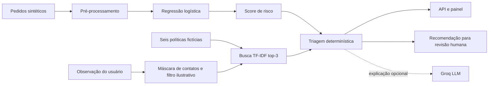

# Arquitetura do PedidoPulse

O protótipo separa três responsabilidades: estimar risco, consultar políticas fictícias e organizar uma triagem revisável. A separação importa porque **prever um atraso não equivale a decidir uma ação operacional**.

## Fluxo de dados

1. `app/data.py` cria pedidos fictícios de forma reproduzível.
2. `app/model.py` treina e avalia um classificador, escolhendo o limiar na validação. Um estudo adicional de sensibilidade vive em `scripts/threshold_experiment.py`.
3. `app/knowledge.py` usa TF-IDF e similaridade de cosseno para localizar políticas relevantes. São somente **seis** políticas de demonstração, sem embeddings nem buscas externas.
4. `app/service.py` combina score, evidência e regras de revisão. A rota `POST /api/triage/{order_id}` expõe o resultado sem executar ações externas.
5. `app/llm.py` aceita opcionalmente uma chave Groq para redigir a explicação. Mesmo nesse modo, o texto gerado não altera a lista de ações.
6. `app/main.py` serve API e assets; `app/static` contém HTML, CSS e JS separados.

## Escolhas e concessões

- **Regressão logística:** fácil de reproduzir e interpretar; não significa que seja o melhor modelo para um cenário real.
- **Divisão cronológica 60/20/20:** organiza os registros por criação e evita ajustar o limiar no conjunto de teste. Os dados, porém, são gerados artificialmente.
- **TF-IDF em vez de embeddings:** permite estudar citações e ranking lexical sem serviço externo. Não modela bem equivalências semânticas complexas.
- **Modo offline:** dá respostas reproduzíveis e permite testar sem chave de LLM.
- **Revisão humana:** a ferramenta não executa cancelamentos, compensações ou comunicação com pessoas.

## Limitações de segurança e operação

A detecção de prompt injection é baseada em expressões regulares simples; a máscara de contatos não cobre todos os formatos possíveis. Não há autenticação, rate limiting, monitoramento, isolamento entre usuários ou aprovação humana implementada fora da interface. Os resultados **não** devem ser interpretados como desempenho validado em operações reais.

As métricas, o estudo de limiares e as dificuldades de implementação estão detalhados em [Decisões e testes](DECISOES_E_TESTES.md).
