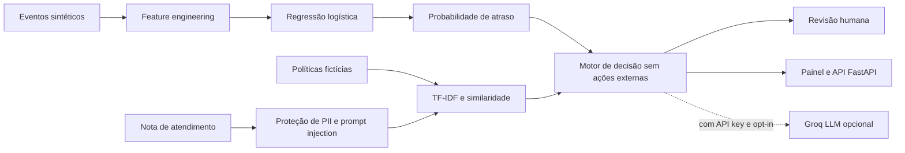

# Arquitetura e decisões de engenharia

## Por que não um chatbot simples?

1. O **ML prevê** um risco probabilístico e é avaliado em holdout cronológico.
2. O **RAG recupera** normas fictícias e retorna IDs que podem ser auditados.
3. O **motor determinístico controla ações**; a LLM opcional não pode decidir reembolso ou cancelamento.
4. **Guardrails** bloqueiam padrões simples de prompt injection e mascaram contato em texto livre.
5. Um **harness de avaliação** mede cobertura da busca lexical; sem claims de produção.

## Limites assumidos

- Os eventos são sintéticos, a probabilidade foi determinada por uma função de geração; bom desempenho no teste não prediz qualidade em dados reais.
- O filtro de prompt injection é heurístico, não é suficiente para segurança real.
- O TF-IDF sem embeddings não é RAG semântico denso; para produção, comparar com embeddings e reranking.
- O modo com Groq exige chave pessoal e faz requisição externa; **não envie dados reais**.
- Não há reembolso, envio de mensagem nem atualização de pedidos reais.
- Os custos de falso negativo e falso positivo são números de exemplo, não números do setor.

## Evoluções interessantes

- Testar calibração probabilística em conjunto independente e monitorar drift temporal.
- Adicionar model cards, rate limiting, autenticação e política de retenção.
- Implementar testes adversariais mais amplos; usar avaliação humana de recomendações.
- Comparar TF-IDF com embeddings, reranking e avaliação de groundedness de modelos.
